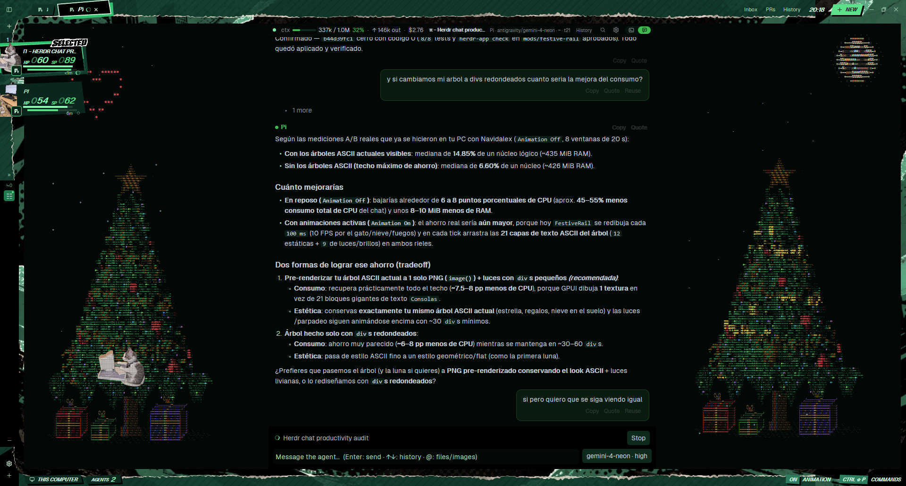

# Navidalex — Herdr Layout

A dark emerald-and-black festive [Herdr](https://herdr.dev) layout combining Persona 5-inspired torn-paper chrome, a rich multi-agent chat interface (`any-chat` for Claude Code, Pi, Codex & OpenCode), GPU-cached ASCII festive side rails (trees, twinkling lights, ASCII full moon, snow, fireworks, patrolling cat), and semantic red/green Git diffs in `file-view` and `changes`.

## Highlights

- **Multi-agent Chat (`any-chat`)**: visual image paste & drag-drop thumbnails, `@` mention autocomplete for images and project files, `↑`/`↓` prompt history with persistent drafts, unified `Model · Thinking` picker for Pi, working interactive choice/question cards (Pi + Claude), `/` autocomplete, `file:line` jump, and live context/cost bar.
- **Festive Side Rails (`festive-rail`)**: 2× pre-rendered transparent `Consolas` ASCII PNG sprites for zero-lag GPU rendering, twinkling light banks, ASCII full moon, heart & Clawd fireworks, and a motion toggle (`Animation On/Off`) in the status bar.
- **Semantic Git Diffs**: explicit Git green (`+`) and Git red (`−`) highlights in `file-view`, `changes`, and inline chat diffs — never washed out by the forest green theme.
- **Workday Title Cards (`hero-legend`)**: subtle Garamond overlays on the hour plus custom prompts (`Dream.`, `Go eat.`, `Run.`).

## Install with your agent

Ask your coding agent inside Herdr:

> Install the `navidalex` layout from `https://github.com/Rae1206/navidalex` following `navidalex/RECIPE.md` without overwriting my existing layouts or unrelated keybindings.

See [`navidalex/RECIPE.md`](navidalex/RECIPE.md) for the complete file map, optional Pi session bridge, and credits.
